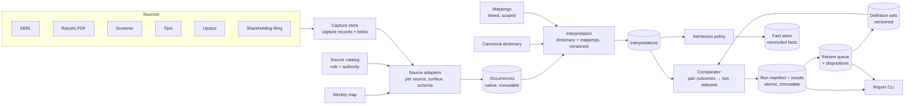

# Canonical financial data dictionary, cross-source comparison and shared store

Status: approved
Approved by: PavanMV (owner), 2026-10-11

## Problem Statement

Equity-OS reads the same figures from up to six sources (exchange XBRL, results PDF, Screener,
Tijori, Upstox, the exchange shareholding filing) with no common definitions. The pilot checks only
XBRL against the PDF; a separate comparator covers four P&L figures for ten companies; every company
needs hand-written configuration. The owner's ~4.5 crore Apar opex gap against Screener cannot be
detected or explained. At full-market scope, per-company patching and storage no longer work.

## Solution

One versioned **canonical field dictionary** lists every figure the product extracts: every filed
line item, plus vendor summary lines expressed as formulas. Each source is mapped into it once per
source surface and schema version, never per company. Source values are kept twice: as the native
occurrence and as a versioned canonical interpretation of it. For every measurement key (§4), the
comparator lines up all eligible observations and reports two separate checks:

- **Extraction check**: two first-party representations of the same filing (XBRL against the PDF).
  Agreement is evidence that extraction is consistent, not that the filing is correct.
- **Independent corroboration**: the first-party value against each independent vendor (Screener,
  Tijori). Agreement under a qualified mapping is evidence of cross-source agreement; disagreement
  points to a mapping, definition or source error. Upstox shares Screener's upstream lineage and is
  diagnostic only (§5).

Pairs get typed outcomes, cells two statuses from exhaustive tables, every non-trusted outcome a
review route; no blended score. One shared PostgreSQL database serves the full market; companies are
added by identifier alone; delivery is staged (§0).

Evidence base: [canonical field coverage inventory](../research/canonical-field-coverage-inventory.md)
(224 draft rows × 6 sources). Prior measurements:
[three-source first measurement](../research/three-source-first-measurement.md),
[Upstox Lane B first measurement](../research/upstox-lane-b-first-measurement.md).

## User Stories

As the analyst, I want:

1. one list of every financial field, to see coverage by source;
2. every source's value side by side, so a disagreement shows where to look;
3. extraction and corroboration reported separately, to know whether a figure is merely extracted
   consistently or also independently confirmed;
4. a known, evidenced vendor definition difference (e.g. Screener "Expenses" excludes finance costs
   and depreciation) explained, and an unexplained one flagged, never a guess trusted;
5. filing-only figures (e.g. OCI lines, diluted EPS, the September half-year balance sheet) marked
   filing-only, not failures;
6. figures no source carries routed to an alternate review, so gaps are visible;
7. a failed source shown as unavailable, never as absence;
8. PBT before and after the share of associates, headline after, XBRL figure traceable;
9. OPM and other ratios computed by registered formulas, reproducible and comparable with vendors';
10. the shareholding pattern compared across the exchange filing, Screener and Tijori (Upstox as a
    diagnostic), with explicit categories and denominators;
11. a report per company and period and a persistent review queue with dispositions;
12. any past comparison exactly reproducible from its recorded inputs.

As the operator, I want:

13. to add a company by identifier alone, with an explicit refusal when identity cannot be verified;
14. one PostgreSQL database in a host directory I choose, with tested backup and restore of data
    and captures.

As a future developer, I want market, framework, currency and fiscal calendar explicit on every
value (15), so a foreign market adds adapters, not a redesign.

## Implementation Decisions

### Owner decisions recorded in this spec (2026-10-11, PavanMV)

- **Target scope:** the full Indian listed market for the data layer. Foreign markets come later;
  only design room is built now.
- **One shared database:** PostgreSQL in a Docker container from the repository compose definition,
  latest stable major (18.x; image pinned to `postgres:18.6`). Version 19 is beta and excluded.
- **Database files are bind-mounted** to an uncommitted host directory outside the repository,
  never a container-managed volume.
- **Loopback only, non-default port:** `127.0.0.1`, never 5432 (other instances share this
  machine); locally 55432, set in the untracked environment file.
- **Corroboration is two checks** (extraction; independent corroboration), with no blended score.
- **Rows are every filed line item plus vendor formula rows**, not a curated subset.
- **Shareholding is in scope.** Prices and market data, corporate actions and management guidance
  are not part of this table.
- **Headline PBT is after the share of associates.** Both PBT concepts are kept.

Confirmed defaults (formerly open questions; confirmed by the owner 2026-10-11):

| # | Decision | Applied in |
|---|---|---|
| D1 | Credentials in the local untracked `.env` are a local-only exception to the secrets-manager rule; a secrets manager is required before any non-local or multi-user use | §6 credentials |
| D2 | Backups are `pg_dump` plus a matched capture archive (records and blobs) and manifest, with a restore test | §6 backup |
| D3 | A mapping is `EQUIVALENCE_DEMONSTRATED` only with ≥5 distinct companies in scope, including ≥1 discriminating case where competing definitions exist | §2 qualification |
| D4 | The old 0.5-crore Tijori precision is withdrawn; agreements measured under it are re-measured before they count | §5 precision |
| D5 | The legacy import covers only the fact-store files, not workflow or state stores | §6 import |
| D6 | Effective tax rate uses PBT **before** share of associates (standard practice, since that share is post-tax); headline PBT stays after associates | §1 PBT |

### Decision-register amendment (scope stated exactly)

A register amendment record, citing this spec, is part of Stage 1. It changes only:

- §G, last bullet ("migration to … PostgreSQL before observed need"), overridden for the financial
  data layer by owner decision, not by a §H trigger;
- the first-release target for the **financial data layer** (dictionary, mappings, observation
  store, comparator): the full Indian listed market.

Nothing else changes: other §G deferrals (incl. automated initiation, full-universe daily
research, unattended capture, workflow engines), §H triggers and financial-sector and foreign
adapter deferrals stay in force.

### 0. Staged delivery

One spec, four stages. Each stage is independently verifiable; a later stage never relaxes an
earlier stage's acceptance.

| Stage | Delivers | Depends on | Accepted when |
|---|---|---|---|
| 1. Dictionary, mappings, comparison | PostgreSQL service and the evidence schema (occurrences, interpretations, definition sets, runs, results, review queue). Dictionary v1 manifest. Mappings for XBRL (both taxonomies), PDF, Screener, Tijori and Upstox (diagnostic-only, §3). Comparator, run manifests, report and queue commands. Runs over **retained captures** for Apar plus the ten watchlist companies. | — | Criteria pass vs frozen manifest |
| 2. Legacy store migration and cutover | Lossless import of the legacy SQLite fact store. Fact-store interfaces backed by PostgreSQL. Admission policy. Backup and restore. Cutover and rollback. | 1 | Criteria pass; owner approves cutover |
| 3. Shareholding filing source | Acquisition, retention and mapping of the exchange shareholding filing. Shareholding rows, category hierarchy and comparison. | 1 (and source authority, §7) | Criteria pass vs frozen manifest |
| 4. Identifier-only onboarding | Identity discovery and verification per namespace. Onboarding outcomes. Settings derived from evidence. | 1, 2 | Criteria pass vs frozen manifest |

Until Stage 2 cutover, legacy SQLite stays the fact system of record; Stage 1 writes only evidence
tables.

### 1. Canonical field dictionary

**Content.** A versioned definition artifact in the repository, reviewed like code. Each row
defines: a stable, standard-neutral canonical id; family (P&L, balance sheet, cash flow, segment,
shareholding, derived); meaning; value kind; duration or instant; sign convention; aggregation
behaviour; applicability rule; basis applicability; dimension template where one applies; and, for
derived rows, a formula over other canonical ids.

**Value kinds** are distinct and never interconverted implicitly:

| Kind | Canonical unit |
|---|---|
| Currency amount | Exact decimal, currency base unit |
| Per-share amount | Currency per share |
| Count | Integer; exact (singleton interval, §5) unless an evidenced precision rule declares rounding |
| Percentage | Percentage points |
| Ratio | Decimal fraction |
| Days | Decimal days (e.g. receivable or inventory days) |

**Numeric only.** Segment, holder and share-class names are dimension members or metadata, not
rows. Grouped inventory entries become one id each (e.g. working-capital days, one per measure). Stage 1
publishes a **resolved v1 manifest** with counts per family and the instantiation rules for each
template (segments, other-expense and OCI detail, shareholding categories).

**Scope of v1.** Indian non-financial Ind AS issuers, seeded from the inventory, revised in Stage 1;
other frameworks' rows come with those frameworks.

**Lifecycle.** Published versions are immutable semver (major, owner-approved: removal or meaning
change; minor: additions; patch: wording). A new meaning gets a new id; the old is deprecated with a
successor pointer. Splits, merges and aliases are explicit
versioned relationships; additions need reviewed evidence; results name their dictionary version.

**Unmapped native rows** are kept with exact anchor as `UNMAPPED` and queued as addition
candidates, never dropped or nearest-label mapped.

**Applicability** is decided before any value is examined, from reporting regime, document type and
filing package, period kind, and the entity's basis status. Under the listing regulations the
balance sheet and cash flow are required in half-year and annual results; for Q1 and Q3 those rows
are `NOT_APPLICABLE` unless the package contains the statement (then preserved, never
fabricated). A row is `NO_SOURCE` only when applicable.

**Two PBT concepts.**

| Id | Meaning | Used by |
|---|---|---|
| `profit_before_tax` | Before share of associates/JV (XBRL `ProfitBeforeTax` position) | Effective tax rate (D6) |
| `profit_before_tax_incl_associates` | After share of associates/JV | **Headline PBT**; PBT margin |

A source line is assigned to one of these by evidenced arithmetic or layout (subtotal
relationships, associates line position, segment reconciliation), never by the label "Profit
before tax". If the headline is not reported separately it is computed as `profit_before_tax +
share_of_profit_associates_jv`; otherwise it is absent, never substituted. Every formula names its
PBT id. Effective tax rate is the filed `tax_expense` ÷ `profit_before_tax`; tax is never derived
as PBT − PAT (that mixes in the associates share), and without a filed tax expense it is
`OPERAND_MISSING`. Legacy role translation: `FactRole.PROFIT_BEFORE_TAX` (XBRL `ProfitBeforeTax`)
↔ `profit_before_tax`; `FactRole.PROFIT_FOR_PERIOD` ↔ `profit_for_period`; consumers showing a
headline PBT read `profit_before_tax_incl_associates`.

**Derived rows** include EBITDA excluding other income, OPM, PBT margin, effective tax rate and
vendor-definition rows such as `opex_excl_finance_and_da` (the Screener and Tijori "Expenses"
construction). Rules:

- **Operands.** Each operand is a declared canonical id with a **temporal role** against the output
  period, an inclusive date interval: `DURATION` (same interval), `CLOSING` (instant at its end
  date), `OPENING` (instant at the day before its start, i.e. the preceding closing date: Apar H1
  FY26 opening cash is at 31 March 2025) or `AVERAGE` (mean of opening and closing). Only the
  role-aligned key is selected; an instant at any other date is never used. Operands share entity,
  basis, framework, currency and dimension set, except through a **dimensional aggregation**: a
  declared operator summing a closed list of input members of one axis into a declared output
  member (e.g. DII from its named subcategories; a segment total). Every listed member needs a
  value (else `OPERAND_MISSING`); the loader rejects lists where one member aggregates another
  (double counting).
  Each formula declares its unit algebra (e.g. amount ÷ amount → ratio; ratio × 100 → percentage;
  amount ÷ amount × days → days) and day-count convention (actual days in the output interval);
  the loader rejects operand kinds or roles that do not fit it.
- **Arithmetic.** Evaluation is exact rational arithmetic over +, −, ×, ÷. The result is stored
  rounded half-even to the policy's pinned scale per value kind; its uncertainty bounds are
  rounded outward (lower down, upper up). The rounding policy id is recorded in the calculation
  trace and pinned in the run manifest.
- Nothing is zero-filled; every evaluation ends in a calculation state (§5).
- Dangling ids, unit-algebra mismatches and cycles make the dictionary invalid at load.
- Every computed value stores a calculation trace: formula version, operand interpretation ids,
  values and bounds, rounding policy.
- Vendor formula strings (e.g. Tijori's) are evidence hints, never executable.

**Period aggregation** is declared per concept:

- Additive duration amounts may be derived: Q4 = FY − 9M, H2 = FY − H1, TTM = four contiguous
  quarters. Operands share basis, framework, currency and dimensions, and must be
  **revision-compatible**: each is its own as-reported selection (§4) at the run cutoff, and the
  derivation is refused with `REVISION_INCOMPATIBLE` if any operand period has an eligible
  restatement (`ISSUER_RESTATEMENT` or `COMPARATIVE_RESTATEMENT`) differing from the selected value
  beyond tolerance (§5), since that would mix restated and original bases.
- Instants, per-share values, ratios, percentages, days and counts are never summed. TTM EPS, for
  example, is reported or not available.
- A derived period value carries identity `DERIVED` (vs `REPORTED`) and keeps its operand trace.
  Reported and derived values for the same key are compared, never merged.

### 2. Source mappings

**Mapping identity:** source; surface or table (e.g. Screener quarterly vs annual, Tijori `qt_c` vs
`pl_c_d`, Upstox summary vs `full_statement`); schema identity (for XBRL, namespace URI plus
version, not prefix; both `in-capmkt` and `in-bse-fin`); applicable basis and period kinds; the
contextual selector. An unknown schema version or surface fails as `UNSUPPORTED_SCHEMA`, never
best-effort. Each entry ties a native field to a canonical id directly or through a formula, with
sign, scale, unit transform (§4) and precision rule (§5); first-party entries included.

**Evidence tiers** reuse the existing three-source comparator's tiers:

| Tier | Meaning | May conclude |
|---|---|---|
| `EQUIVALENCE_DEMONSTRATED` | Equivalence measured within a recorded qualification scope | qualified AGREE; MISMATCH |
| `RELATED_NOT_EQUIVALENT` | Related concept, known not to be identical | neither |
| `EQUIVALENCE_UNPROVEN` | Plausible, not measured | neither |

**Qualification scope.** A demonstrated mapping records schema versions, surfaces, basis, period
kinds, any further conditions (e.g. discontinued operations zero), the fixture set (capture ids and
hashes), exclusions and the sample rule it satisfied (D3; a discriminating case is one where competing
definitions such as associates, NCI, discontinued operations or exceptional items differ). Outside
its scope a mapping is `EQUIVALENCE_UNPROVEN`. Scope is by surface, schema, basis and period kind,
not the fixtures' calendar quarter.

**First-party alignment.** An XBRL–PDF pair's tier is the weaker of its two mapping entries' tiers,
except that a recorded **filing-specific alignment proof** (both representations tie to the same
subtotal relationships or layout position in that filing) counts as demonstrated for that filing
only. The D3 sample rule does not apply to such a proof.

**Computed values.** A derived side's effective tier is the weakest of its formula mapping's tier
and every operand's scoped tier (or alignment proof); a pair takes the weaker side. Any unproven
required operand bars qualified `AGREE` unless a recorded proof qualifies the whole construction
(D3 applied to the formula). The calculation trace pins each operand's tier evidence.

**Known traps are mapping facts with evidence:**

- Tijori `qt_c` "Net Profit" → `profit_continuing_after_tax` (continuing PAT, before associates in
  the XBRL layout), never `profit_for_period`. Candidate scope: `qt_c`, quarterly, consolidated,
  `in-bse-fin`, discontinued operations zero. The nine Q3 FY25 measurements (HFCL, LAURUSLABS,
  THERMAX and TITAN are the discriminating cases) qualify it only after re-measurement at displayed
  precision (D4); until then it is `EQUIVALENCE_UNPROVEN`. Discontinued-operation cases stay
  unproven.
- Screener "Other Income" → `other_income + exceptional_items`.
- Screener "Total Liabilities" is the balance-sheet total and maps to no liabilities row.
- Screener "Borrowings" + "Other Liabilities" includes NCI. It maps to vendor-aggregate row
  `liabilities_incl_nci` and is compared at that aggregate level only: the first-party side is the
  derived `total_liabilities + non_controlling_interest`, both first-party operands. The vendor
  value is never adjusted with first-party NCI. Without a first-party NCI value the comparison is
  `OPERAND_MISSING`.
- Upstox summary `operating_profit` → PBT and `revenue` → total income; both unproven.
  `operating_profit` equals Screener's PBT to the crore (12/12), the recorded shared lineage.
- Upstox `full_statement` is annual even on quarterly requests (§3).
- Vendor EPS (Screener "EPS in Rs", Tijori `adj_eps_abs`) is vendor-derived: related to filed basic
  EPS, not equivalent.

**First-party folding and mistagging** (Apar: ROU assets, lease liabilities, earlier-year tax,
OCI/TCI attribution, segment eliminations). Native XBRL facts are always preserved. Where folding is
evidenced, either an aggregate bridge row is defined (e.g. other intangibles including ROU) or a
scoped override is recorded with evidence; an evidenced tagging difference becomes a definition
record (§5). Unresolved cases stay `ANOMALY`. **Per-company overrides** are allowed only as scoped,
evidenced mapping entries, never as the normal way to support a company.

**Within-vendor contradictions.** Two surfaces of one vendor can carry the same measurement key
(e.g. Upstox summary vs `full_statement` for NETWEB, POLYCAB, CGPOWER). Both occurrences survive and
each surface yields its own pair (diagnostic for Upstox). The vendor's pairs become `NOT_COMPARABLE` with
`VENDOR_INTERNAL_CONFLICT` only when the two surface values are key-compatible and their intervals
(§5) are disjoint, or when explicit contradictory semantics are evidenced (e.g. different declared
periodicity for the same key), and no evidenced precedence between the surfaces is recorded.

### 3. Identity, settings, periods and source authority

**Three identity layers**, each with a stable internal id:

| Layer | Identifies | External identifiers |
|---|---|---|
| Reporting entity | Who prepares the statements | XBRL entity id, CIN |
| Security | An instrument | ISIN, share class |
| Listing | A security on a venue | NSE symbol, BSE scrip code |

Financial observations attach to the entity; shareholding to entity and share class. Identifier
relationships are temporal with provenance; ISIN and symbol changes, symbol reuse, mergers,
demergers and delistings are explicit identity events, never inferred. The existing entity identity
map is the latest slice.

**Settings derived from evidence, versioned:** identifiers, printed units, document locations,
fiscal calendar (incl. year-end changes), currencies, framework and basis status. Observations
carry their own period, currency and framework, so a settings change cannot reinterpret them.
Hand-written per-quarter configuration is retired for new companies, kept as pilot history.

**Segment members.** Reportable segments are canonical members per entity, versioned with
valid-from/to and the evidence (filing segment note) that defines them. Renames are aliases; splits
and merges are recorded member relationships, and values are compared across a split or merge only
through an explicitly defined aggregate member. Alignment is by evidenced member, never by ordinal.

**Basis** comes from the filing's declaration and per-surface vendor verification (Tijori unproven
until verified). Standalone-only issuers (e.g. NETWEB) have consolidated rows `NOT_APPLICABLE`. A
degenerate or empty vendor consolidated response is rejected and yields no values. Standalone is
never stored or compared as consolidated.

**Periods.** Every period is an exact interval or instant from evidence; the period kind (quarter,
half-year, nine-month, year, TTM) is derived from the interval, never a label. Response periodicity
is checked separately from request parameters (Upstox annual data on a quarterly request is stored
as annual). Tijori's date-labelled final `pl_*` column is TTM, never a fiscal period. Year-to-date
columns sharing a quarter-end are separated by interval. An undeterminable interval is kept as
`PERIOD_AMBIGUOUS`, not comparable. Reporting cadence is separate from measurement type.

**Source authority.** Adapters check the source catalog's role and retention authority before
capturing or interpreting. Diagnostic-only sources never corroborate; unregistered surfaces yield
`NOT_AUTHORISED`. Upstox (absent from the catalog today because of its proven Screener lineage)
is registered diagnostic-only (owner decision 2026-09-03): its statement values are a parse-check on
our Screener scraping, never a vote; its shareholding stays diagnostic until independence is
measured.

### 4. Evidence model: occurrences, interpretations, revisions

**Two layers.**

- **Occurrence:** what a source said, immutable and lossless: source, surface, native field
  (element, label or JSON path); raw value text with raw unit, scale and sign; native context (XBRL
  context and dimensions, or PDF column header); missing-value state; disclosure metadata (e.g.
  holder-list threshold and regulatory format version); and the **capture reference** (capture
  record id; request identity; blob content hash; typed anchor: page and line, XBRL fact id or JSON
  path; acquisition and registration timestamps).
- **Interpretation:** an occurrence mapped under a named mapping version into the measurement key,
  with normalised value, uncertainty interval, transform trace, evidence tier and recorded-at time.
  Re-mapping adds interpretations, never rewriting occurrences or older interpretations.

Capture records and blobs stay in the existing snapshot store, referenced by the database. Only
complete, **comparison-eligible** (§8) captures are interpreted.

**Measurement key**, shared by adapters, storage, formulas and comparison:

| Part | Notes |
|---|---|
| Reporting entity id | §3 |
| Canonical id | §1 |
| Period | Exact start and end, or instant |
| Basis | Consolidated / standalone |
| Accounting framework | e.g. `IND_AS`; a different framework is never comparable |
| Currency and value kind | Canonical unit per kind (§1) |
| Dimension set | Normalised (axis → canonical member) pairs; the empty set is explicit, not null. Includes, where the template declares them: segment member and **elimination basis** (pre-/post-elimination); shareholding category, share class and **denominator** (total shares, voting rights, promoter holding) |

**Normalisation.** Currency amounts become exact base-unit decimals from the presented scale. Each
mapping declares the source's sign convention and transform (e.g. positive cash outflows), traced;
raw values are kept.

**Missing-value states.** Absence is never a value. `VALUE` (a number) and `ZERO_PRINTED` (a
printed `0` / `0.00`) are values. `NIL` (XBRL `xsi:nil`), `DASH` (PDF "–", unless an evidenced
source rule reads it as zero), `BLANK`, `NOT_PRESENTED` (line absent) and `SOURCE_NULL` (vendor
`null` or missing key) are no value; nothing is zero-filled.

**Acquisition and extraction outcomes**, per source × surface × entity × period, separate from
comparison. The existing acquisition-outcome contract is extended, not replaced.

| Outcome | Meaning | Source state (§5) |
|---|---|---|
| `COMPLETE` | Complete body captured and interpreted | value or no value per cell |
| `NOT_PUBLISHED` | The source verifiably has no document for this period | no value |
| `PARTIAL` | Body truncated or incomplete | unavailable |
| `FAILED` | Request or transport failure | unavailable |
| `NOT_AUTHORISED` | No authority for this surface (§3) | unavailable |
| `IDENTITY_REJECTED` | Response belongs to a different or unverified entity | unavailable |
| `UNSUPPORTED_SCHEMA` | Unknown taxonomy or surface version | unavailable |
| `PARSE_FAILED` | Extraction failed | unavailable |

Any unavailable source state of a non-diagnostic source marks the run `INCOMPLETE`. A failed
source never makes a value look filing-only or absent. Every acquisition attempt is recorded with
its outcome, separately from usable evidence.

**Revisions and time.** Occurrences keep the fact store's valid time, knowledge time (when the
source made the value public) and first-seen time (when we captured it). Every new occurrence or
interpretation records one revision cause, matching register B-11: `ISSUER_RESTATEMENT` (prior
period restated), `ISSUER_CORRECTION` (revised filing for the same period),
`COMPARATIVE_RESTATEMENT` (a later filing's comparative differs from the original),
`VENDOR_UPDATE`, `PARSER_REEXTRACTION`, `MANUAL_CORRECTION`, `NORMALISATION_POLICY_CHANGE`.

- **Filing package:** one submission's XBRL and PDF share a package id; extraction pairs within it.
- **Cutoff:** every run takes an explicit cutoff (default: run start). An occurrence is eligible
  only if its knowledge time and first-seen time are both at or before the cutoff. A source with
  no publication time (e.g. Upstox, vendor HTML) records knowledge time `UNKNOWN`; its
  availability is the verified capture registration time, never the period or filing date.
- **Mode:** `AS_KNOWN` (default) also requires every interpretation, including manual
  corrections and re-extractions, to be recorded at or before the cutoff, reproducing what was
  known then. `RETROSPECTIVE` applies the cutoff to occurrences only and uses the pinned (possibly
  newer) versions' interpretations. The mode is pinned in the manifest.
- **Selection, first-party as reported (default), per package.** A package's **as-reported
  keys** are those whose period ends on its reporting-period end date: the current quarter, any
  current year-to-date duration (H1, 9M, FY) and the period-end instant (balance sheet,
  shareholding date). For a reporting-period end the latest eligible package is selected
  **within its filing family** (financial results, shareholding; each with its own correction or
  replacement lineage, and only packages matching the entity, basis and framework are eligible; an
  issuer correction supersedes its original), and every as-reported key of that family takes that
  package's state; a package of another family sharing the end date never affects it: a line the correction omits is no value, never revived from the original, unless the
  correction records that it replaces only named statements. Earlier-period columns are
  comparatives, stored as `COMPARATIVE_RESTATEMENT` where they differ, surfaced, never replacing a
  selection. Exception for formulas: an `OPENING` (or `AVERAGE`) operand uses the opening instant
  the same package discloses (cash-flow opening balance, balance-sheet comparative) when present,
  so the formula is package-consistent; otherwise that instant's own selection. The trace records
  which; the historical selection is unchanged and a differing disclosure is surfaced.
- **Interpretation within a package:** candidates are only interpretations made under the run's
  pinned mapping-set, normalisation-policy and extractor versions. A `MANUAL_CORRECTION` or
  `PARSER_REEXTRACTION` interpretation names the one it supersedes; the unsuperseded candidate is
  selected. Several unsuperseded candidates make the side `INVALID` (`INTERPRETATION_AMBIGUOUS`).
- **Selection, vendor:** per surface, the latest eligible acquisition attempt decides. The
  latest attempt's outcome maps to a state by the outcome table (`COMPLETE` value or no value;
  `NOT_PUBLISHED` no value; every other outcome unavailable), even when an older complete capture
  exists (no fallback); the older capture is listed with the operational failure. **Legacy facts:**
  fact-store canonical selections resolve as of the cutoff (register C-15).

**Boundary with the fact store.** Occurrences and interpretations are a raw evidence layer,
separate from the fact store's reconciled facts. Admission creates a candidate fact through the
existing write path when: the observation is first-party; its extraction status in a named run is
`AGREE`, or `NOT_APPLICABLE` for a single-representation family; and no non-diagnostic `HIGH` item is open
for the cell in the queue overlay at admission time. The admission record stores the run id and the queue
overlay position it used. Vendor observations, including API-document-anchored ones, never get
fact authority (the API-document bar stays). Existing consumers keep the fact-store interfaces
(fact roles, translated per §1; canonical selections; stored fact references); Stage 2 moves them
onto PostgreSQL.

### 5. Comparison

**Source roles per family.**

| Family | First-party value | Extraction pair | Vendors that may corroborate | Diagnostic only |
|---|---|---|---|---|
| P&L, balance sheet, cash flow, segment | Selected package's representative (below) | XBRL vs PDF, same package | Screener, Tijori: mapped surfaces | Upstox statements: parse-check against Screener |
| Shareholding | Exchange shareholding filing | Two representations of the same filing if retained captures show both; otherwise `NOT_APPLICABLE` | Screener, Tijori: mapped surfaces | Upstox, until its independence is measured |
| Derived | Formula over first-party representative operands | Formula evaluated separately per representation (below) | Vendor-**published** value, or one computed from operands of the same vendor surface and capture (flagged computed) | As its family |

**Diagnostic pairs** (Upstox vs Screener on the same key, and vs first-party) use the pair table
and are reported, but never enter the state vector, either status, trust or run completeness;
Upstox failures are listed as diagnostic only. Routing below.

**Representative value.** The first-party side of every vendor pair is the XBRL value if present,
else the PDF value, recorded. When extraction is not `AGREE`, vendor pairs against the other
representation are shown as diagnostics outside the corroboration status. The vendor side of a derived comparison never uses first-party
operands (circular corroboration); a vendor-published derived value is its own occurrence.

**Agreement test.** Sides are within tolerance iff their uncertainty intervals (below) intersect;
the report shows the difference and the interval gap.

**Pair outcomes** (one first-party side against one other side), first matching row wins:

| # | Condition | Pair outcome |
|---|---|---|
| 1 | Keys incompatible (period, basis, framework, currency, kind, dimension member unresolved), period ambiguous, precision unsupported, either side `INVALID`, or vendor internal conflict (§2) | `NOT_COMPARABLE` + reason code |
| 2 | Within tolerance; tier demonstrated within scope (or filing-specific alignment proof, §2) | `AGREE` |
| 3 | Within tolerance; otherwise | `AGREE_UNQUALIFIED` |
| 4 | Outside tolerance; a definition record in the pinned definition set (below) reconciles the difference to within tolerance | `DEFINITION_DIFFERENCE` |
| 5 | Outside tolerance; tier demonstrated within scope | `MISMATCH` |
| 6 | Outside tolerance; otherwise | `ANOMALY` (cause unknown) |

`MISMATCH` and `ANOMALY` carry the existing triage: `STRUCTURAL` (scale factor 10, 100 or 1000, or
sign flip), `MAGNITUDE` (relative difference ≥ the comparison policy's versioned threshold) or
`NOISE`. Policy v1 sets the threshold at **0.5%**, deliberately replacing the existing comparator's
20%: since only gaps outside both precision intervals reach triage, a 21-crore THERMAX revenue gap
(0.83–0.84%, `NOISE` in the first measurement) is a real unexplained difference and must be
reviewed. Also re-routed from `NOISE` to `MAGNITUDE`: THERMAX (5.4%) and ETERNAL (14.3%) vendor
EPS. Pairs where one side has no value are not pair outcomes; they feed the source states below.

**Definition records** hold scope (mapping, measurement or filing), evidence reference and explained
amount, are created only by an evidenced disposition or mapping change (never from a label), and
are published in immutable, versioned **definition sets**; a run pins one set version.

**Tolerance and precision.** A native value's interval is value ± half its declared precision after
normalisation; an exact count's is the singleton value, so adjacent counts never agree. A derived value's interval is propagated by interval arithmetic over its operands'
intervals (+, −, ×, and ÷ where the denominator interval excludes zero), bounds rounded outward.
Anything else is `NOT_COMPARABLE` with `PRECISION_UNSUPPORTED`; precision is never invented.

| Source form | Declared precision |
|---|---|
| XBRL | `decimals` attribute |
| PDF | Printed decimals at the printed scale |
| Vendor HTML | Displayed decimals at the displayed scale |
| Vendor API | The source's documented precision, or a scoped precision rule recorded as a mapping fact with evidence; otherwise `PRECISION_UNSUPPORTED`. Serialised digits alone are never precision |

A coarser declared precision is allowed only as an evidenced mapping fact. Per D4, the earlier
0.5-crore declaration for Tijori's two-decimal values is withdrawn, and agreements measured under
it are re-measured before they count as qualification evidence.

**Source states.** For each cell, the result stores one state per source: first-party (from the
representative's package) and each vendor surface that maps the row. States are `VALUE`,
`NO_VALUE` (complete capture without a value, or `NOT_PUBLISHED`), `UNAVAILABLE` (§4 outcomes) and
`INVALID` (a value refused for a typed reason; its pairs are `NOT_COMPARABLE` with that reason,
routed MEDIUM). The state vector is shown with both statuses.

**Calculation states.** Each derived side (per first-party representation, or a vendor computed
value) takes one state, first matching row wins, before presence rules apply:

| # | State | Condition | Source state |
|---|---|---|---|
| 1 | `OPERAND_UNAVAILABLE` | Any operand `UNAVAILABLE` | `UNAVAILABLE` |
| 1a | `OPERAND_INVALID` | Any operand `INVALID` or without supported precision, even if it carries a number | `INVALID`, operand reasons propagated |
| 2 | `OPERAND_MISSING` | Any operand without a (role-aligned) value | `NO_VALUE` |
| 3 | `REVISION_INCOMPATIBLE` | §1 period aggregation | `INVALID` |
| 4 | `UNDEFINED` | Denominator interval contains zero | `INVALID` |
| 5 | `COMPUTED` | Otherwise | `VALUE` |

So a valid vendor value against a first-party `OPERAND_MISSING` is `VENDOR_ONLY`; against a
first-party `INVALID` it is a `NOT_COMPARABLE` pair and status.

**Extraction status** per cell, first matching row wins:

| # | Condition | Status |
|---|---|---|
| 1 | Family has no paired first-party representation | `NOT_APPLICABLE` |
| 2 | Either representation `UNAVAILABLE` | `UNAVAILABLE` |
| 2a | Either representation `INVALID` | `NOT_COMPARABLE` + reason |
| 3 | Neither has a value | `NONE` |
| 4 | Only one has a value | `ONE_SIDE_XBRL` / `ONE_SIDE_PDF` |
| 5 | Pair `NOT_COMPARABLE` | `NOT_COMPARABLE` |
| 6 | Pair `AGREE` | `AGREE` |
| 7 | Pair `AGREE_UNQUALIFIED` (alignment not evidenced) | `AGREE_UNQUALIFIED` |
| 8 | Pair `DEFINITION_DIFFERENCE` | `TAGGING_DIFFERENCE` |
| 9 | Pair `MISMATCH` / `ANOMALY` | `DISAGREE` |

**Derived extraction status.** The formula is evaluated over XBRL operands and over PDF operands
(single-representation operands shared) and the two results go through the table above as a pair;
`NOT_APPLICABLE` when every operand family is single-representation. Each side's calculation state
gives its source state. If the pair would be `DISAGREE`, the explained amounts of operands with
`TAGGING_DIFFERENCE` are applied; the status is `TAGGING_DIFFERENCE` only if the adjusted intervals
then intersect, otherwise `DISAGREE` (HIGH).

**Corroboration status** per cell, first matching row wins. F is the first-party state; vendor
states and pairs as above.

| # | Condition | Status |
|---|---|---|
| 1 | Row not applicable (§1) | `NOT_APPLICABLE` |
| 2 | F `UNAVAILABLE` | `UNAVAILABLE` |
| 2a | F `INVALID` | `NOT_COMPARABLE` + reason |
| 3 | F `NO_VALUE`, any vendor `VALUE` | `VENDOR_ONLY` |
| 4 | F `NO_VALUE`, any vendor `UNAVAILABLE` | `UNAVAILABLE` |
| 4a | F `NO_VALUE`, any vendor `INVALID` | `NOT_COMPARABLE` + vendor reason |
| 5 | F `NO_VALUE`, otherwise (incl. no mapped vendor) | `NO_SOURCE` |
| 6 | F `VALUE`, no vendor `VALUE` or `INVALID`, any vendor `UNAVAILABLE` | `UNAVAILABLE` |
| 7 | F `VALUE`, no vendor `VALUE` or `INVALID` (incl. no mapped vendor) | `FILING_ONLY` |
| 8 | Any pair `MISMATCH` | `CONFLICT`, even if another vendor agrees |
| 9 | Any pair `AGREE` | `CORROBORATED` |
| 10 | Any pair `AGREE_UNQUALIFIED` | `AGREES_UNQUALIFIED` |
| 11 | Any pair `ANOMALY` | `ANOMALY` |
| 12 | Any pair `DEFINITION_DIFFERENCE` | `DEFINITION_DIFFERENCE` |
| 13 | All pairs `NOT_COMPARABLE` | `NOT_COMPARABLE` |

Rows 8–13 apply when F is `VALUE` and ≥1 vendor is `VALUE` or `INVALID` (whose pair is
`NOT_COMPARABLE`); another vendor's `UNAVAILABLE` leaves the status unchanged but shows in the
state vector and makes the run `INCOMPLETE`.

**Trust** is a view, not a stored run result: a cell is **trusted** when, in a named run, extraction
is `AGREE` (or `NOT_APPLICABLE` with a first-party value) and corroboration is `CORROBORATED`, and
the queue overlay at a stated time has no open non-diagnostic `HIGH` item on the cell. Every other combination is
shown as its two statuses, state vector and pair outcomes. No blended score exists.

**Review routing.** Pair outcomes are routed **independently of the cell status**, so a pair
problem is never hidden by another vendor's agreement.

| Outcome | Severity | Route / reason |
|---|---|---|
| Extraction `DISAGREE` | HIGH | Disposition: parser defect, filer inconsistency or tagging difference |
| Corroboration `CONFLICT` (each `MISMATCH` pair) | HIGH | Mapping, definition or source error |
| Any non-diagnostic pair `ANOMALY`: `STRUCTURAL` / `MAGNITUDE` / `NOISE` | HIGH / MEDIUM / none | Scale or sign fault / unexplained difference / counted in report |
| Diagnostic Upstox pair `MISMATCH` / `ANOMALY` (any class; takes precedence over the generic rows; never a trust or admission blocker) | MEDIUM | `PARSE_CHECK_DISAGREE`: our Screener parser |
| Any pair `NOT_COMPARABLE`; extraction `NOT_COMPARABLE` | MEDIUM | Mapping or period defect, with reason code |
| `VENDOR_ONLY`, `NO_SOURCE` | MEDIUM | Alternate route (model read with code-verified quote, or manual read); only routing is built |
| Extraction `ONE_SIDE_*`; `UNMAPPED` occurrence | LOW | Folding bridge or mapping gap; dictionary-addition candidate |
| Onboarding `IDENTITY_CONFLICT` (§8) | HIGH | Operator queue |
| `UNAVAILABLE` | run-level | Run's operational failures, not cell items |
| `AGREE_UNQUALIFIED` / `AGREES_UNQUALIFIED` | none | Recorded as qualification evidence |
| All other statuses | none | Shown with explanation or evidence reference |

**Review queue.** Persistent and append-only; an item is keyed by measurement key, pair (or
extraction), outcome and input hash. Same inputs reuse the open item; changed inputs open a new,
linked one. Dispositions are new records:
`ACCEPTED_AS_DEFINITION` (proposes a definition record for the next definition set),
`MAPPING_FIX`, `PARSER_DEFECT`, `FILER_INCONSISTENCY`, `ALTERNATE_READ_REQUIRED`, or `DISMISSED`
with a reason. Dispositions never edit results; their effect on classification appears only in a
new run that pins the resulting definition set or mapping version. The **queue overlay** (open
items and dispositions as of a time) is the only review state that reaches trust or admission.

**Runs and reproducibility.** Every run stores an immutable **run manifest**: run id, cutoff and
mode; requested scope (entities, periods, bases, sources); dictionary, mapping-set,
normalisation-policy, extractor, rounding-policy, formula-set, definition-set and comparison-policy
versions; code version (commit); exact input occurrence and interpretation ids with capture
hashes; acquisition-attempt and outcome record ids, including failed ones; identity-verification,
settings and applicability evidence ids; run status (`COMPLETE`, or `INCOMPLETE` with its
operational failures). Review state is not a run input. Results become visible only when the
whole run commits; a failed run leaves none. Runs are **identical** when request scope, mode,
pinned versions and resolved input set are equal; the uniqueness key hashes these, not the cutoff
timestamp, so concurrent default-cutoff reruns over unchanged evidence return one run. Replay
uses only the manifest, reproducing source states (incl. negative ones) without consulting current
observations, identity, settings, definitions or queue state.

**Analyst interface (minimum CLI):**

- **Report:** one company and period, every applicable row: each source's value, unit and state,
  both statuses, pair outcomes (incl. diagnostic) with difference and gap, explanations, queue
  items, and trust as of the overlay time shown.
- **Queue:** list by severity and status; record dispositions. **Run:** start with a cutoff.

Exit status distinguishes: success without open `HIGH` items; success with them; `INCOMPLETE`;
failure (including an unreachable database, which leaves no partial run).

### 6. Shared store

**Service contract.** Compose runs `postgres:18.6` with the data directory bind-mounted from the
configured host path at the image's mount point (18 keeps PGDATA in a version-specific
subdirectory), on `127.0.0.1` and the configured port; database name and role are local
configuration. **Tests use their own test database**, never the main one. Minor upgrade: change
the pin, recreate, verify. Major: restore a logical backup into a new data directory or
`pg_upgrade`, keeping the old one until verified.

**Schema and integrity.**

- One database holds all markets; market, framework and currency are columns.
- Evidence tables (occurrences, interpretations, definition sets, run manifests, results, queue
  records, dispositions, imported legacy facts and selections) are immutable: update and delete are
  rejected by triggers, and the **runtime role** lacks UPDATE and DELETE on them. A separate
  **migration role** owns the schema.
- Foreign keys enforce every reference; optional key parts use an explicit empty value or
  nulls-equal unique constraints so identities hold.
- Pooled access with explicit connect and statement timeouts; parameterised queries only.

**Concurrency and idempotency.** Unique constraints enforce identity; writes are idempotent
insert-on-conflict. Revision ordinals and selection sequences are allocated under a row lock or
serialisable isolation with predecessor checks, retrying serialisation failures at most three
times, then failing loudly. Run publication is one transaction.

**Credentials (D1).** Credentials come from the untracked local environment file that compose
reads, loaded through `pydantic-settings` at the composition root and injected at construction;
business logic never reads the environment. They never appear in logs, captures, run manifests or
committed files; manifests record database identity (host, port, name) only. Non-local or
multi-user deployment requires the secrets manager first.

**Backup and restore (D2).**

- A backup is a **matched set** under one backup id: a `pg_dump` custom-format dump; an archive of
  every capture record and blob the database references, directly or through the legacy evidence
  binding (§6 import); and a manifest of those capture hashes.
  The manifest is generated in the same exported database snapshot the dump uses, so it lists
  exactly the references in the dump, and every archived blob is hash-verified when the set is
  written.
- A directory copy is a backup only with the container stopped.
- A restore test restores the set into a fresh instance, a fresh test database and an empty
  snapshot-store directory, then checks row counts, referential integrity, that every referenced
  capture (incl. every bound imported-fact original) resolves with a matching hash, and that
  replaying one stored run reproduces its results.
- An off-machine destination is deferred.

**Legacy SQLite import (Stage 2, D5).**

1. **Scope.** The legacy fact-store database files only: the `facts` and `canonical_selections`
   tables and their immutability triggers. The import manifest lists exact files and fingerprints,
   confirmed by the owner before import.
2. **Freeze.** Legacy writers stop. Each file is opened read-only, never through the store's
   initialising constructor, and fingerprinted (SHA-256).
3. **Lossless import.** Each file gets a stable **origin-store id** (from its fingerprint);
   every legacy id and reference, incl. consumers' stored fact references, is origin-qualified
   (origin, id), so colliding ids across files never merge. Preserved byte for byte: row ids,
   content identities and value hashes; revision families and ordinals; canonical status and
   selection timestamps; selection ids, sequences and predecessor links; stored selection digests
   and legacy-baseline flags. No identity is recomputed. Canonical ids attach through a versioned
   translation table (legacy fact → measurement key), which is evidence in its own right. A
   verified **evidence binding** sidecar ties each imported fact's provenance (source hash, anchor)
   to a retained capture record and blob, leaving legacy bytes unchanged; a preflight lists
   unresolved originals for owner confirmation before import.
4. **Reconciliation.** Counts match; per-row hashes are equal; every selection digest recomputed
   from imported rows equals the stored digest; canonical retrieval returns identical results from
   SQLite and PostgreSQL at several cutoffs; source fingerprints are unchanged after import.
5. **Repeatability.** Re-importing the same fingerprint changes nothing. A different fingerprint is
   refused unless started as a new import.
6. **Cutover.** After reconciliation and owner approval, consumers switch configuration to
   PostgreSQL, and a cutover marker records the last imported ids. Legacy files stay read-only.
   Post-cutover writes allocate ids in a PostgreSQL-native origin and record their target legacy
   store.
7. **Rollback.** Allowed until the owner retires the legacy files; every post-marker write is
   identifiable. Rollback freezes fact-store writers (writes are refused), seals a high-water mark,
   replays writes through it in order into a copy of each target legacy file via the legacy write
   path, which re-allocates ids. Ids are not preserved: PostgreSQL-native ids may collide with
   legacy ids, and the selection digest binds `row_id`, `predecessor_id` and predecessor SHA-256, so
   the legacy copy holds a **translated chain**: each selection is re-appended in order with
   translated ids, so its digest is recomputed by the legacy path. A recorded correspondence
   (native id/digest ↔ legacy id/digest) resolves every reference, and an independent verifier
   recomputes each legacy digest from its translated fields and checks it equals the recorded legacy
   digest, with counts and value hashes unchanged; native digests are not expected to equal legacy
   ones. It then switches
   configuration while frozen and resumes writers. If anything fails to replay or reconcile, nothing switches and
   writers resume on PostgreSQL.

### 7. New source: exchange shareholding filing (Stage 3)

**Prerequisite.** Before any capture, the filing is registered in the source catalog with role and
retention authority, then retained like other filings as the first-party shareholding source.

**Measurement contract:**

- **Instant:** the shareholding date (quarterly is the cadence, not the period).
- **Category hierarchy,** versioned per regulatory format: promoter and promoter group; public,
  split into institutions and non-institutions with nested subcategories; non-promoter non-public.
  Vendor "Public" maps only to the matching aggregate; "Retail" is never equated to "Public".
- **Denominator** (total shares, voting rights, or promoter holding for pledge %) and **share
  class** are key dimensions (§4), so measures with different denominators are never paired.
- **Completeness:** holder-level rows are thresholded; occurrences keep threshold and format
  version; drill-downs are `THRESHOLDED`; an absent holder is unknown, never zero.
- **Extraction check:** paired only if the retained filing provides two representations of the
  same submission; otherwise `NOT_APPLICABLE`, and trust rests on corroboration (§5).
- Tijori shareholding is unverified (the fixture is synthetic); real captures are a prerequisite
  for any Tijori shareholding mapping above `EQUIVALENCE_UNPROVEN`.

### 8. Identifier-only onboarding (Stage 4)

**Discovery captures** (instrument master, vendor lookups, filings fetched for identity checks) are
retained as identity evidence, never interpreted for comparison. A namespace's captures become
**comparison-eligible** only once it is verified.

| Namespace | Discovery | Verification (all required) |
|---|---|---|
| Exchange symbol, scrip code, ISIN | Exchange instrument master | Master and filing agree |
| XBRL entity id | The company's filings | Matches the listing's ISIN and name across filings |
| Screener, Tijori, Upstox ids | Vendor lookup by exchange identifier | Page or response carries the same ISIN or exchange code; basis check passes (§3) |

| Outcome | Meaning |
|---|---|
| `ONBOARDED` | All namespaces verified |
| `PARTIAL` | Unverified namespaces excluded and listed; their source states are `UNAVAILABLE`, so runs are `INCOMPLETE` (diagnostic Upstox excepted, §5) |
| `IDENTITY_CONFLICT` | Ambiguous or contradictory identifiers: discovery captures kept as rejection evidence; nothing comparison-eligible; capture for the entity stops; HIGH operator item |
| `UNSUPPORTED` | e.g. bank, NBFC or insurer, a foreign listing, or no Ind AS filing |

Onboarding fails closed (never guesses a slug or picks a candidate) and schedules nothing.

### Component boundaries

Components talk only via occurrences, interpretations and measurement keys.

## Success Criteria

Every stage's acceptance run must exactly match a **frozen expected manifest**, hand-verified from
source documents before the run, never generated by the code under test: per company and period,
applicable rows, values and units, pair outcomes, source states, both statuses, queue items, run
status.

### Stage 1: dictionary, mappings, comparison (retained captures)

- **Happy path**
  - Apar and the ten watchlist companies: every applicable manifest row matches; run `COMPLETE`.
  - Apar Q2 FY26 consolidated: revenue, total income, total expenses, `profit_for_period` and basic
    EPS have extraction `AGREE` (by demonstrated mapping or filing-specific alignment proof);
    `profit_before_tax` = 340.56 crore, `profit_before_tax_incl_associates` = 340.53 crore, headline
    340.53; OPM = 8.06% with a stored calculation trace.
  - Apar against Screener "Expenses", on `opex_excl_finance_and_da`: vendor side is Screener's
    published value, filing side is computed from first-party operands. The outcome equals the one
    pre-registered from a hand computation; without an evidenced definition record, any residual gap
    beyond tolerance is `ANOMALY` and routed, never `DEFINITION_DIFFERENCE`.
  - Nine Q3 FY25 filings, Tijori `qt_c` "Net Profit": interpreted as
    `profit_continuing_after_tax`, never `profit_for_period`, so HFCL, LAURUSLABS, THERMAX and TITAN
    raise no profit-for-period conflict. The manifest pre-registers the displayed-precision
    re-measurement: ≥5 agreeing incl. a discriminating case → demonstrated, pairs `AGREE`;
    otherwise `AGREE_UNQUALIFIED`.
  - THERMAX revenue vs Screener and Tijori: `ANOMALY` (`MAGNITUDE` under the 0.5% v1 threshold),
    MEDIUM, cause unresolved.
  - Upstox: an Upstox statement value agreeing with the filing changes no status or trust; an
    Upstox–Screener disagreement queues `PARSE_CHECK_DISAGREE` MEDIUM; an Upstox failure leaves
    the run `COMPLETE`.
  - A dictionary, mapping or definition-set change yields a new version and run; replaying the
    earlier manifest reproduces it exactly. `ACCEPTED_AS_DEFINITION` changes no result.
- **Error and edge cases**
  - One demonstrated vendor mismatches while another agrees: `CONFLICT`, not trusted.
  - One vendor agrees while another pair is `NOT_COMPARABLE`: `CORROBORATED`, and the
    `NOT_COMPARABLE` pair is still queued MEDIUM.
  - Numeric agreement under an unproven mapping: `AGREES_UNQUALIFIED`, not trusted.
  - A period, basis, framework, currency or kind mismatch: `NOT_COMPARABLE` with reason code.
  - NETWEB (standalone-only): consolidated rows `NOT_APPLICABLE`, never filled from standalone;
    the degenerate Screener page and empty Upstox consolidated response yield no values.
  - Upstox summary vs `full_statement` (NETWEB, POLYCAB) with disjoint intervals: diagnostic pairs
    `NOT_COMPARABLE` with `VENDOR_INTERNAL_CONFLICT`, routed MEDIUM, both occurrences retained.
    Surface values within tolerance of each other raise no conflict.
  - Invalid vendor: F `VALUE` with the only vendor `INVALID` gives `NOT_COMPARABLE`, never
    `FILING_ONLY`; F `NO_VALUE` with it gives `NOT_COMPARABLE`, never `NO_SOURCE`.
  - Adjacent integer share counts (n vs n + 1) do not agree.
  - Screener "Total Liabilities" populates no liabilities row; Borrowings + Other Liabilities is
    compared only against first-party `liabilities_incl_nci`.
  - Tijori's TTM column is stored as TTM; Upstox annual data on a quarterly request as annual.
  - Q1 or Q3 with no balance sheet filed: balance-sheet rows `NOT_APPLICABLE`, not `NO_SOURCE`. The
    September half-year balance sheet with no vendor counterpart: `FILING_ONLY`.
  - **Failure fixture:** one vendor capture `FAILED`. Cells where that vendor is the only mapped
    vendor and the filing has a value are `UNAVAILABLE`, never `FILING_ONLY`; cells where another
    vendor has a value take their status from that pair, with the failed vendor visible in the state
    vector. The run is `INCOMPLETE` and exits with that status. A complete capture followed by a
    failed attempt for the same surface is also `UNAVAILABLE`, `INCOMPLETE`; followed by
    `NOT_PUBLISHED` it is no value and the run stays complete.
  - **Revision fixture:** a retained filing and a later filing's comparative for the same period.
    Before the later filing's cutoff only the original is visible; after it, the comparative is
    stored as `COMPARATIVE_RESTATEMENT` and surfaced, and the selection is unchanged. A Q4 = FY − 9M
    derivation over a restated 9M gives `REVISION_INCOMPATIBLE`. A vendor capture is never eligible
    before its registration time.
  - **Calculation fixtures:** receivable days (closing receivables ÷ revenue × days) computes
    with a stored trace; an opening-date receivables instant is never used. Apar H1 FY26 opening
    cash is the 31 March 2025 instant disclosed in the H1 cash-flow statement, not
    `OPERAND_MISSING`. An `INVALID` operand still carrying a number gives `OPERAND_INVALID`. An
    Apar segment total by dimensional aggregation over its evidenced members computes; a missing
    listed member gives `OPERAND_MISSING`. A valid vendor OPM
    against a first-party `OPERAND_MISSING` is `VENDOR_ONLY`; against `UNDEFINED` or
    `REVISION_INCOMPATIBLE` it is `NOT_COMPARABLE`, MEDIUM. One operand's explained tagging
    difference plus an unrelated operand discrepancy stays `DISAGREE`, HIGH. A computed pair
    matching numerically with one unproven operand is `AGREE_UNQUALIFIED`.
  - **Correction fixtures:** an original extraction and its manual correction in one package select
    the correction, but an `AS_KNOWN` run with a cutoff before the correction selects the original;
    two unsuperseded interpretations give `INTERPRETATION_AMBIGUOUS`. An issuer correction package
    omitting a line the original populated gives no value for it. **Family fixture:** a
    shareholding submission and a financial-results package sharing a period end date select
    independently; a later shareholding package never empties results keys (nor the reverse).
  - **Dimensional fixture:** Apar segments align by evidenced member, never by ordinal; pre- and
    post-elimination segment assets are distinct keys and never paired.
  - An unmapped native line is kept as `UNMAPPED` and queued LOW.
  - **Diagnostic fixture:** a structural Upstox disagreement on an otherwise trusted cell leaves
    it trusted, with only a MEDIUM `PARSE_CHECK_DISAGREE` item.
  - Identical reruns, including two concurrent default-cutoff ones over unchanged evidence, yield
    one run and no duplicate rows. Replaying a run with a failed attempt reproduces `UNAVAILABLE`.
  - The runtime role cannot update or delete evidence rows.
  - An unreachable database fails the run (nonzero exit, no visible partial run).

### Stage 2: legacy store migration and cutover

- Legacy import reconciliation passes in full (§6 step 4) with source fingerprints unchanged;
  re-importing the same fingerprint changes nothing. Two stores with colliding row and selection
  ids import without merging; every imported fact's evidence binding resolves.
- The existing fact-store consumer tests pass against PostgreSQL; cutoff queries return the same
  canonical selections as SQLite.
- Apar Q2 FY26 consumer report (nonzero associates): tax expense 88.83 crore (filed, not
  PBT − PAT = 88.86), effective tax rate 26.08% (88.83 ÷ 340.56), headline PBT 340.53, PAT
  251.70.
- A vendor observation cannot be admitted as a fact (API-document bar holds).
- The Stage 1 diagnostic fixture's cell remains admissible; the open `PARSE_CHECK_DISAGREE` item
  does not block admission.
- A matched backup restores into a fresh instance and empty snapshot-store directory; every
  referenced capture resolves with a matching hash, and one stored run replays identically.
- Data survives container recreation; the service listens only on `127.0.0.1`, configured port.
- A rollback rehearsal with post-cutover fact writes interleaved across two stores replays and
  reconciles them (translated chain) into the legacy copies, then reproduces post-write behaviour
  on SQLite. **Digest fixture:** ids change on replay and ≥2 successive canonical decisions for one
  content identity verify as a chain in the legacy copy (recomputed digests match the old/new
  correspondence). A write that cannot be
  replayed causes rollback to be refused with no configuration change. A write attempted during
  rollback is refused while frozen, never lost.

### Stage 3: shareholding filing

- Shareholding filings for Apar and ≥2 watchlist companies, captured under recorded authority,
  carry explicit instant, category, denominator, share class and completeness; values match.
- Promoter, public and institution aggregates are compared with each vendor's retained real capture
  (required for Tijori and Upstox; Upstox pairs diagnostic), with outcomes and statuses as in the
  manifest. Measures with different denominators are never paired.
- A vendor DII built by dimensional aggregation of its listed subcategories is compared at the DII
  aggregate only.
- Holder drill-downs are `THRESHOLDED` (threshold recorded); absent holders are never zero.
- Extraction status is `NOT_APPLICABLE` or paired, as the manifest records from the retained
  representations.

### Stage 4: identifier-only onboarding

- A held-out company, recorded before Stage 4, unused in development, with pre-registered outcome
  and run status: given only its identifier, it reaches `ONBOARDED` (run `COMPLETE`) or `PARTIAL`
  (run `INCOMPLETE`, listing exactly the excluded namespaces) with per-namespace verification
  evidence, and its comparison run matches the manifest without code or configuration changes.
- An ambiguous-identifier fixture gives `IDENTITY_CONFLICT`: discovery captures retained, no
  comparison-eligible captures or interpretations, a HIGH operator item.
- A financial-sector issuer gives `UNSUPPORTED`; an unauthorised surface gives `NOT_AUTHORISED`.

### Out of bounds

- Whether a corroborated value is economically correct (e.g. a filing error).
- Full-market performance targets (measured as coverage grows).

## Testing Decisions

- **Integration tests** (the main seam), on the real PostgreSQL test database: adapters through
  runs, results and queue over retained captures; load validation (incl. duplicate selectors) failing loudly; concurrent runs
  and imports; refused updates.
- **End-to-end tests**, one per stage, against its frozen expected manifest, covering the stage's
  full path (Stage 2: import → reconciliation → consumers → backup/restore → replay → rollback).
- **Fixtures** are the real retained captures named in Success Criteria; failure, ambiguity and
  correction fixtures withhold, mark or re-interpret them, never invent values.
- **Unit tests only for dynamic financial logic** (never declarations): interval agreement and
  propagation with outward rounding; rational formula evaluation; normalisation; the pair,
  extraction, derived-extraction, calculation-state and corroboration tables, row by row; period and
  dimensional aggregation, temporal roles, revision compatibility; package selection under cutoff
  and mode; the magnitude threshold. Documented traps are covered through behaviour.
- **Prior art:** three-source comparator tests and Lane B measurements are adapted; SQLite fact-store
  tests move to PostgreSQL in Stage 2 after capturing SQLite behaviour as the baseline.

## Out of Scope

| Item | Reason | Status |
|---|---|---|
| Bank, NBFC and insurer row sets | Different statement formats | Deferred |
| Foreign-market adapters and non-Ind AS rows | Design room only | Deferred |
| Prices and market data | Separate Upstox lane | Rejected for this table |
| Corporate actions and management guidance | Separate data contracts (§3 records identifier changes only) | Rejected for this table |
| Executing the alternate review route (model or manual read) | Only the routing is built | Deferred |
| Scheduled or unattended capture across the market | Needs separate authority; not granted by the register amendment | Deferred |
| Partitioning, replication, read replicas, high availability | Wait for measured need | Deferred |
| Off-machine backup destination | Separate owner decision | Deferred |
| Fabricating unfiled quarterly balance sheet or cash flow | Filed statements are preserved (§1) | Rejected |
| Any per-cell blended trust score | Owner decision: two checks only | Rejected |

## Open Questions

Owner questions are settled as D1–D6. Remaining questions, each resolved by evidence:

- Whether Screener or Tijori have an uncaptured half-year balance-sheet view (Stage 1 capture).
- Whether the shareholding filing has two representations (an extraction check); settled at
  Stage 3 start.
- What the THERMAX ~21 crore item is (`ANOMALY` until a filing-backed definition record exists).
- Upstox `full_statement` "Profit After Tax": `profit_for_period` or continuing PAT (unproven until
  measured).
- Which Upstox API fields have documented precision (until then `PRECISION_UNSUPPORTED`), and
  whether Upstox shareholding is independent of Screener (diagnostic until measured).

## Further Notes

- **Evidence is thin:** nine companies, one quarter (older taxonomy); Apar alone for the new
  taxonomy and PDF. Hence tiers gate `MISMATCH` and `AGREE`.
- **Bead `eqos-al0`** contradicts the inventory; its target is `profit_continuing_after_tax`.

### Review disposition

Rounds 1–3: all findings adopted (50; 17 + N1–N9; F1–F3, R3-1–R3-3). Fresh critical review:
all 17 adopted (THERMAX via a 0.5% magnitude threshold).
